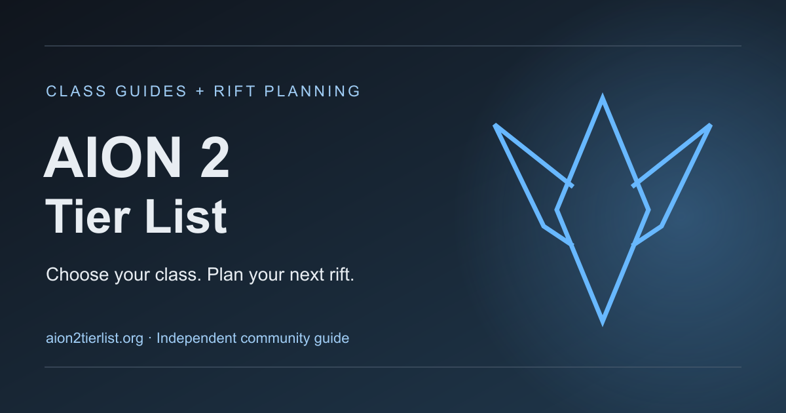

# AION 2 Tier List & Rift Timer

**Find your class. Understand your strengths. Plan your next rift.**

[Visit aion2tierlist.org](https://aion2tierlist.org/) — an independent AION 2 companion for class selection, beginner guides and regional rift planning.

### Choose a class that fits your playstyle

Explore **PvE and PvP tier lists** with attributed ranking sources, then discover what each class brings to a fight. Read about strengths, trade-offs and solo play before choosing your character.

| Gladiator | Ranger | Sorcerer |
| :---: | :---: | :---: |
|  |  |  |
| Melee combat | Ranged attacks | Magic damage |

- **Nine class guides:** character artwork, class emblems, skill introductions and official videos.
- **A practical starting point:** beginner recommendations, learning priorities and practice checklists.
- **Side-by-side comparisons:** compare two classes and save your favorites for another visit.
- **Your next step:** find the matching regional official website and available download links from the guides.

[Explore the tier list](https://aion2tierlist.org/) · [Browse all classes](https://aion2tierlist.org/classes/) · [Compare two classes](https://aion2tierlist.org/compare/)

### Make the next rift fit your schedule

Choose your game region and display timezone to view estimated rift openings. Use the next eight sessions or enter your own play window to find a session that fits.

- Quick **3-hour and 24-hour** planning options, plus custom time windows.
- Share a selected session with friends or copy a **Discord timestamp**.
- Add a session to your calendar or set a reminder while the page remains open.
- Check the schedule source and review date directly alongside the tool.

Taiwan and Korea schedules use official regular rules; international schedules are labeled community references. Maintenance and in-game notices take priority.

**[Open the AION 2 Rift Timer →](https://aion2tierlist.org/rift-timer/)**

## Read rankings as a starting point

A tier list is most useful when it helps you ask better questions. A position in a table cannot fully describe the experience of learning a class, joining a group or playing on your preferred schedule. Compare the explanation behind a ranking with the activities you actually enjoy. A class that suits a coordinated party may ask different things of its player than one chosen mainly for solo sessions.

Keep PvE and PvP context separate. Fighting computer-controlled encounters and responding to other players place different demands on timing, positioning and decision making. Switching the context of the tier list should change the question you are asking, not merely the letter you hope to see beside a favorite character. Read source attribution and review information before treating any ranking as current advice.

## Explore the class guides

The class pages combine artwork with explanations of roles, strengths and trade-offs. Start by identifying whether you prefer close-range pressure, ranged positioning, support responsibilities or another style. Then read the matching guide slowly enough to notice the compromises. A strong description of damage does not automatically tell you how forgiving the class will feel during your first sessions.

Use the practice material as a way to structure learning. Choose one habit to observe, such as maintaining useful positioning or recognizing an opportunity to support the group. Return to the guide after trying that habit. This is more informative than trying to memorize every detail before creating a character. Descriptive explanations should also be distinguished from official skill names or translations.

## Compare before committing

The comparison page helps you put two choices beside each other. Pick alternatives that genuinely interest you rather than comparing a favorite with something you would never play. Think about the kind of responsibility you want during a difficult encounter, the amount of attention you enjoy giving to positioning, and whether your friends already have a role they need filled.

Favorites can make it easier to return to a shortlist, but they are a convenience rather than an account-wide promise. If browser preferences are removed, a saved choice may no longer be available on that device. Keep a simple note of your preferred classes if you want to discuss them elsewhere. The important outcome is an informed choice, not a perfect score from a comparison.

## Plan a rift with the correct context

Before using a time estimate, confirm the game region and the display timezone. Those are different decisions: where you play determines the relevant schedule, while the display timezone determines how you read it. A convenient-looking time from the wrong region is not useful. Shared sessions should be checked by everyone involved rather than assumed to match automatically.

Use the planning window to narrow the sessions you can realistically attend. Leave room for logging in, preparing your character and meeting your group. A calendar entry or copied timestamp helps communicate an intention; it cannot ensure that a game event will take place exactly as expected. Maintenance notices and in-game announcements remain more important than a third-party estimate.

## Keep expectations grounded

The timer distinguishes schedule references and exposes review information so that visitors can judge the context. Where information conflicts or becomes outdated, avoid interpreting an attractive countdown as certainty. Check the relevant official notice before arranging a session that would be costly or inconvenient to miss.

AION 2 Tier List is a companion resource rather than the game operator. It does not control balance changes, account access, regional availability or event maintenance. Use official regional destinations for game account questions. Use this website to organize your reading, compare options and prepare useful questions for your next session.

## Return with a specific question

You can make each visit short and productive. Open a class guide to understand one trade-off, compare two candidates before a discussion with friends, or inspect a rift window before agreeing on a time. The site works best as a reference you return to, rather than a single verdict that replaces your own experience.

The artwork identifies the classes being discussed and remains associated with its respective rights holders. This is an independent fan resource, not an official NCSOFT publication. Visitor information and contact links are available through the website's footer.
