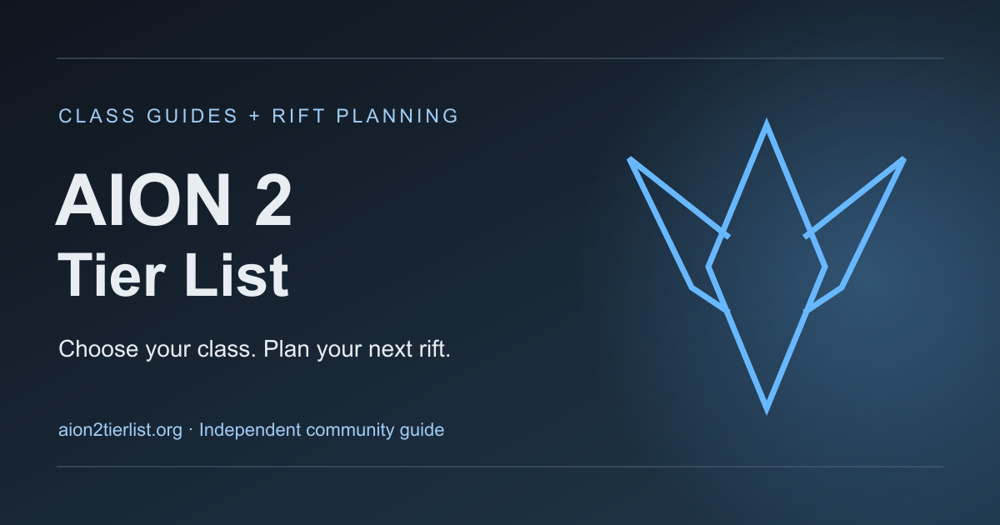

# AION 2 Tier List & Rift Timer

[English](#english) · [繁體中文](#繁體中文)

## English

**Find your class. Understand your strengths. Plan your next rift.**

[Visit aion2tierlist.org](https://aion2tierlist.org/) — an independent AION 2 companion for class selection, beginner guides and regional rift planning.

### Choose a class that fits your playstyle

Explore **PvE and PvP tier lists** with attributed ranking sources, then discover what each class brings to a fight. Read about strengths, trade-offs and solo play before choosing your character.

| Gladiator | Ranger | Sorcerer |
| :---: | :---: | :---: |
|  |  |  |
| Melee combat | Ranged attacks | Magic damage |

- **Nine class guides:** character artwork, class emblems, skill introductions and official videos.
- **A practical starting point:** beginner recommendations, learning priorities and practice checklists.
- **Side-by-side comparisons:** compare two classes and save your favorites for another visit.
- **Your next step:** find the matching regional official website and available download links from the guides.

[Explore the tier list](https://aion2tierlist.org/) · [Browse all classes](https://aion2tierlist.org/classes/) · [Compare two classes](https://aion2tierlist.org/compare/)

### Make the next rift fit your schedule

Choose your game region and display timezone to view estimated rift openings. Use the next eight sessions or enter your own play window to find a session that fits.

- Quick **3-hour and 24-hour** planning options, plus custom time windows.
- Share a selected session with friends or copy a **Discord timestamp**.
- Add a session to your calendar or set a reminder while the page remains open.
- Check the schedule source and review date directly alongside the tool.

Taiwan and Korea schedules use official regular rules; international schedules are labeled community references. Maintenance and in-game notices take priority.

**[Open the AION 2 Rift Timer →](https://aion2tierlist.org/rift-timer/)**

## 繁體中文

**找到適合你的職業，掌握上手方向，安排下一場時空裂縫。**

[前往 aion2tierlist.org](https://aion2tierlist.org/) — 結合職業排行榜、新手攻略與裂縫時間規劃的 AION 2 獨立玩家網站，網站介面以英文呈現。

### 從排行榜開始，選出適合自己的職業

查看 **PvE 與 PvP 職業排行榜**，搭配標明來源的排名、職業優勢、操作取捨與單人遊玩建議，了解每個職業的特色，再決定自己的冒險方向。

| 守護星 | 治癒星 | 護法星 |
| :---: | :---: | :---: |
|  |  |  |
| 前排防護 | 隊伍治療 | 輔助增益 |

- **九大職業圖文指南：**人物圖片、職業標誌、技能介紹與官方影片。
- **新手入門方向：**依照喜好的玩法挑選職業，查看練習重點與學習清單。
- **雙職業比較與收藏：**並排了解兩個職業的差異，收藏感興趣的選擇。
- **銜接官方遊戲入口：**選好職業後，前往對應地區的官方網站及可用下載頁面。

[查看職業排行榜](https://aion2tierlist.org/) · [瀏覽全部職業](https://aion2tierlist.org/classes/) · [比較兩個職業](https://aion2tierlist.org/compare/)

### 讓裂縫時間配合你的遊玩安排

自行選擇遊戲地區與顯示時區，查看預計開放倒數及接下來八個場次。輸入自己的遊玩時段，找出適合參加的場次。

- 提供 **3 小時、24 小時**快捷規劃，以及自訂時段篩選。
- 分享指定場次，或複製 **Discord 時間標記**與朋友約時間。
- 將場次加入行事曆，或在頁面保持開啟時使用提醒。
- 在工具旁查看排期來源與核對日期。

台服與韓服採用官方常規排期；國際地區使用清楚標示的社群參考時間。實際開放情況仍以維護公告及遊戲內通知為準。

**[開啟 AION 2 裂縫計時器 →](https://aion2tierlist.org/rift-timer/)**

---

[aion2tierlist.org](https://aion2tierlist.org/) · [About / 關於本站](https://aion2tierlist.org/about/) · [Contact / 聯絡我們](https://aion2tierlist.org/contact/)

Independent fan resource; not affiliated with NCSOFT. AION 2 names and game artwork belong to their respective owners. / 本站為獨立玩家資源，與 NCSOFT 無隸屬關係；AION 2 名稱與遊戲圖片歸各權利人所有。
